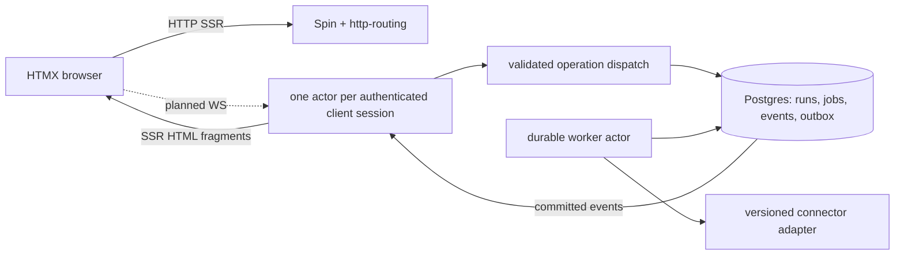

# Target architecture and integration boundaries

## Request and execution paths

Only the HTTP SSR path and schema are implemented. Arrows involving persistent
workers, session actors, or connector effects are the target design.

## One WebSocket actor per client session

Define a client session as an authenticated browser client, not every tab and
not the user's entire login account. A registry maps a verified opaque session
ID to exactly one live actor; a registry lease/fencing epoch prevents two server
instances from both owning it. A new socket attaches to that actor. Reconnect
replaces a stale transport while retaining bounded subscription state; multiple
tabs must have separate client session IDs unless an explicit shared-worker
transport is introduced. User identity and workspace access come from verified
server session state, never from form fields or HTMX HEADERS.

Before upgrade: authenticate, verify expiration/revocation, check Origin against
an explicit allowlist, and bind the permitted workspace. After upgrade: bounded
text frames, bounded mailbox/outbound queue, deadline/idle policy, subscription
limit, capability checks on every operation, and revocation-driven close.
Session actors render authorized fragments from committed events. Disconnect
never cancels a durable run. Slow consumers receive a replay cursor/resnapshot
instruction; they cannot indefinitely retain the worker or its DB transaction.

HTMX's [WS extension](https://htmx.org/extensions/ws/) sends form JSON and consumes
HTML fragments. It is not an api-docs RPC receipt decoder. Use a small adapter
for form JSON → operation request; validate and discard client HEADERS. Return
SSR fragments with stable element IDs. A separate RPC subprotocol may carry v1
`rpc-call`/`rpc-receipt` JSON for generated SDK clients. Do not mix JSON receipts
into the HTMX HTML channel. Authenticated mutations need CSRF binding/replay
protection as well as Origin checks.

The pinned Spin draft cannot upgrade a socket; `/ws` deliberately returns 501.
A core transport capability must retain the socket across actor messages, allow
one owning actor, enforce frame limits and cancellation, and integrate close,
ping/pong, backpressure, and shutdown. Implement and test this in core/Spin
before adding `ws-connect` to the shipped dashboard. The app must not simulate
session actors by starting a new actor for every frame.

## Durable execution

1. Authorize and validate a run request. Validate `inputJson` as bounded JSON
   through the actual Zorde API once located; scalar length alone is insufficient.
2. In one transaction, pin an immutable published version, deduplicate the
   idempotency key, and insert the run plus first jobs and event.
3. Claim ready jobs with `FOR UPDATE SKIP LOCKED`; increment a fencing token and
   commit the lease before performing effects. Never hold row locks during APIs.
4. Connector code receives only explicitly granted credentials/capabilities.
   Each effect has a stable idempotency key, independent of retry attempt number.
5. Complete using the lease owner/fence/deadline predicate. Persist outputs,
   successor jobs, run-state changes and events in that same transaction.
6. Reclaim expired jobs after worker death. A stale worker cannot commit state.
   External side effects can still duplicate without provider deduplication or
   reconciliation; do not claim exactly-once external execution.
7. Pause approvals/waits durably. Resolve an approval with role and revision
   checks, and enqueue its continuation atomically. The request actor can end.

The hardened schema in `migrations/0003_integrity_guards.sql` enforces
same-run job/step and desktop/approval references, append-only events,
immutable version deletion protection, one-way approval decisions and job
lease/fence invariants. Authenticated runtime connections must have no raw
client-controlled SQL access: `SET LOCAL app.workspace_id` is NOT an
authentication mechanism because a client with SQL access can set a custom
PostgreSQL variable. Use separate least-privilege application and migration
roles and verify membership/capabilities in the trusted server before opening
a workspace-scoped transaction. Cross-tenant tests with a genuine untrusted
database principal are still required before any public API is activated.

`contracts/worker.sql` records the claim/complete shape. It is not an implemented
worker and is not yet covered by contention/crash tests. Concurrency admission,
heartbeats, cancellation, deterministic branching/joins, loop/item scoping,
dead-letter handling, jitter, schedule catch-up, and transactional event sequence
allocation are required before durable execution is enabled.

## Code-first models and migrations

`src/models.ores` calls `postgres-orm.ores` to generate `generated/schema.sql`.
That is the DB model authority. JSON Schema and TypeSpec are independently
reviewed I/O peers, checked by TJSV. Neither peer silently rewrites the DB model.
`api-docs` generates docs and client surfaces from the reviewed operation map;
its unfinished SQL emitters are not used or presented as working migrations.

`tool plan NAME` generates candidates for new tables in source dependency order.
It rejects changes to existing tables. For a column/constraint/rename change,
author explicit forward SQL, review backfills/locks, update the snapshot from the
compiled model, and run clean-DB plus previous-release upgrade tests. This initial
migration tool intentionally does not guess destructive diffs. Applied files
are immutable and checksum-locked. Application is a single advisory-locked DB
transaction; failures roll it back. Concurrent-index/online migrations need a
separate reviewed nontransactional procedure. Use expand/backfill/contract and
forward repairs; do not erase data via automatic down migrations.

## Native DB and Zorde gaps

The ORM plans SQL but has no Oreslang connection driver. `oreslang-db` is itself
design-only. Build actor-confined prepared sessions with typed values/rows,
explicit transaction/cancellation ownership, bounded streaming and pool limits.
The current `psql` migration/test tooling is development tooling, not a hidden
alternate-language production backend.

Zorde was searched in local Java, LLVM, and common source plus their GitHub
default branches; no API declaration was found. The standalone native
serialization/validation package exists, but it is not silently substituted for
Zorde. Finding or landing the actual API and testing malformed, duplicate-key,
unknown-field and oversized frames is an outstanding integration prerequisite.

## Delivery sequence

| Milestone | Acceptance evidence |
|---|---|
| foundation (this change) | native Spin/SSR/HTMX, native model/SQL plans, real PG invariants, contract docs, TypeSpec/schema parity, WIT syntax |
| native PG ORM | prepared select/write, rollback, cancellation and pool tests against disposable PG |
| Zorde + RPC dispatch | exact located API, bounded input validation, semantic graph checks, generated client round-trip |
| durable worker | persisted create/publish/run; lease contention, crash/reclaim, stale fence, dedupe/outbox tests |
| session WebSocket | registry uniqueness, reconnect/replay, auth/revocation, limits/backpressure and shutdown tests |
| workflow product | builder/history UI, webhooks/schedules, versioned connectors, approvals, RBAC and retention |
| desktop/document workflows | separate device agent, explicit grants, extraction provenance, review and action receipts |

No production completeness or feature parity with the referenced products is
claimed by the foundation milestone.
